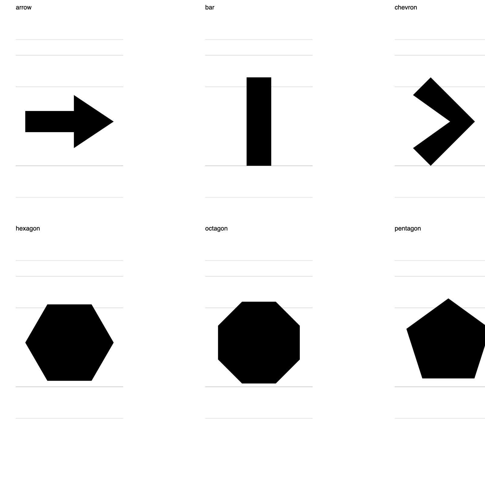
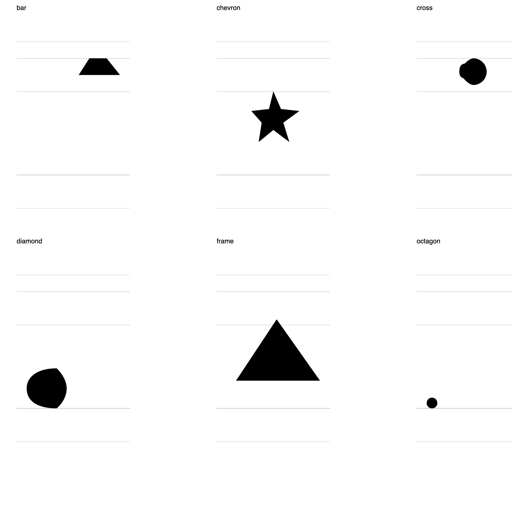

This post is a start-to-finish guide to local AI in
[Runebender](https://runebender.org). You draw a few shapes in a UFO,
train a small model on them, and then type a sentence like "draw a
circle 64 units wide in the lower left" in the editor. The model draws
it. Nothing is downloaded and nothing leaves your machine.

The model is tiny and the shapes are simple. That is the point. This is
the smallest complete loop: your drawings in, a model out, the model
used from the editor. Everything else in local AI is this loop with
more data.

The code and the demo font are in
[runebender-local-ai-demo](https://github.com/eliheuer/runebender-local-ai-demo).
The model runtime is [font-ml](https://github.com/eliheuer/font-ml).
Both are Apache-2.0 or MIT.

{/* DRAFT STATUS: this post is written while the work is built. Sections
    marked TODO are filled from real runs, not written ahead of them. */}

### Section Index

1. What you need
2. Draw the shapes
3. Train the model
4. Draw from text
5. How it works
6. What it cannot do, and what to try next

### 01. What You Need

A mid-range computer: an Apple Silicon laptop, or a Linux PC with a
gaming GPU, or a plain CPU and patience. Two programs: the editor and
`font-ml`, which runs and trains the models.

```sh
cargo install --git https://github.com/eliheuer/runebender-xilem
cargo install --git https://github.com/eliheuer/font-ml --features metal   # macOS
cargo install --git https://github.com/eliheuer/font-ml --features cuda    # Linux with NVIDIA
cargo install --git https://github.com/eliheuer/font-ml                    # CPU
```

Make sure that both programs answer:

```sh
runebender --help
font-ml tasks
```

The second command lists the tasks the models can do. This post uses
two of them: `train-draw` and `draw`.

TODO: screenshot of `font-ml tasks` output.

### 02. Draw the Shapes

A draw model learns from one UFO. Each glyph in it is a shape, and the
glyph's name is the word for the shape. The model learns "circle" from
a glyph named `circle`.

TODO: the editor steps, with screenshots. Open a new UFO, draw a
circle with the shapes tool, name the glyph `circle`. Repeat for a few
shapes. Sizes do not matter; the trainer resizes.

For this post the shapes are generated, so the result repeats on any
machine. The demo repo has them in `fonts/Shapes.ufo`: 16 glyphs, one
shape each, named `circle`, `square`, `triangle`, `star`, `ring`,
`arrow`, and so on. One UFO, no masters, no designspace.



### 03. Train the Model

One command trains the model. It reads one UFO and writes one folder.

```sh
font-ml run train-draw --source fonts/Shapes.ufo --out models/shapes-draw
```

The demo script runs 6000 steps with a model of 256 dims and 6 layers,
5.5 million parameters. On an M4 Pro laptop that takes 12 minutes on
Metal. The run prints:

```
device metal
init loss 8.3, a random model gives 7.3
checkpoint step 500: val loss 3.4 (best, saved)
...
checkpoint step 6000: val loss 1.25 (best, saved)
```

The loss is still falling when the run stops. The same command with
15000 steps takes 29 minutes and ends at 0.51. The checked-in model in
the demo repo is that one. Section 06 shows what the difference means.

### 04. Draw From Text

Open the font with the model folder as the model root:

```sh
RUNEBENDER_MODELS=$PWD/models runebender fonts/Shapes.ufo
```

In the left panel, open Local AI and choose `shapes-draw` under Model.
Open any glyph. A Shapes section appears with one text box. Type a
sentence and click "Draw: this glyph".

TODO: screenshot of the Shapes box and the proposal on the canvas.

The drawing lands in the glyph as a proposal. The status line reports
the contour and point count, and any word the model does not know.
Install keeps it as one undo step. Discard drops it.

The same call from the shell writes a proposal layer into the UFO and
nothing else:

```sh
font-ml run draw --model models/shapes-draw --source fonts/Shapes.ufo \
    --glyph octagon --prompt "a star 300 units wide in the center" --write
runebender proof fonts/Shapes.ufo --layer com.runebender.proposal.draw --glyphs octagon --out star.svg
```

And the same again as a node graph, which the Nodes tab draws and
`runebender nodes run` executes. The Draw node has a text field because
`font-ml tasks` says the task takes a sentence. The editor has no code
for this task.

```sh
runebender nodes run 04-nodes/shapes-draw.nodes.json --font fonts/Shapes.ufo --models models
```

TODO: screenshot of the node graph.

### 05. How It Works

The model is a small decoder transformer, the same kind as a language
model, with about 1 to 5 million parameters. It reads one sequence of
tokens and predicts the next token. A training sequence looks like
this:

```
BOS draw a circle 64 units wide in the lower left SEP ADV C680
MOVE C124 C0 CURVE C124 C18 C110 C32 C92 C32 ... CLOSE EOS
```

Everything before `SEP` is the sentence. The words are tokens, one per
word, and a number is a word too: `64` is one token, not three digits.
After `SEP`, `ADV C680` gives the advance width of the glyph the shape
goes into. The model does not predict this part; the editor supplies
it. After that come the drawing commands, `MOVE`, `LINE`, `CURVE`, and
`CLOSE`, each followed by coordinate tokens on a 2-unit grid. The model
predicts this part. `EOS` ends the drawing.

The trainer makes the sequences from the UFO. For each sample it takes
one glyph, picks a width from 24 to 720, scales the drawing to that
width, picks one of nine positions in a box the height of the cap
height, picks an advance, and moves the drawing there. Then it writes
the sentence from one of six templates with one of the phrases for
that position. A glyph named `circle` becomes thousands of different
sentences and drawings. The model never sees the same sample twice.

The glyph name is the only label. A suffix after a dot is dropped, so
`circle.big` and `circle` both give the word "circle", and one shape
drawn twice is one word with two examples. A name with a hyphen gives
two words: `five-star` is "five star".

At run time the editor sends the sentence and the advance of the open
glyph. The model continues the sequence one token at a time, always
taking the most likely next token, until it produces `EOS`. The same
sentence gives the same drawing every time. The drawing commands become
contours and land in the glyph as a proposal, which you install or
discard.

This is also why the model only knows the words it was trained on.
There is no dictionary and no language model behind it. "heart" is
unknown unless a glyph named `heart` was in the UFO. The fix is to draw
a heart.

### 06. What It Cannot Do, and What to Try Next

Eight sentences drawn by the checked-in model, trained on the 16
glyphs for 15000 steps. Each cell is one glyph; the sentence asked for
a shape, a width, and a position.



The star, the circles, and the triangle are clean. The hexagon and
the ring are rough. At 6000 steps every shape is rough. Training time
is the lever, and 16 drawings are enough data for it to work on.

The model knows 16 shapes and the sentence patterns it was trained on.
It does not know "heart". It does not know "next to the dot of the i".
A sentence like that needs a model that understands glyphs and
English, which is a chat model with tools, not a model you train in
five minutes. The small model is the right first step because every
part of it is yours: the data, the words, the weights.

Three things to try next, in order of effort:

1. Draw more shapes and train again. Each glyph name is one more word.
2. Train longer. The validation loss is still falling when the default
   run stops.
3. Label by hand. A note on a glyph can carry words the name cannot,
   such as "rounded" or "thin". That needs a note field in the editor
   and a trainer that reads it. Both are small.
