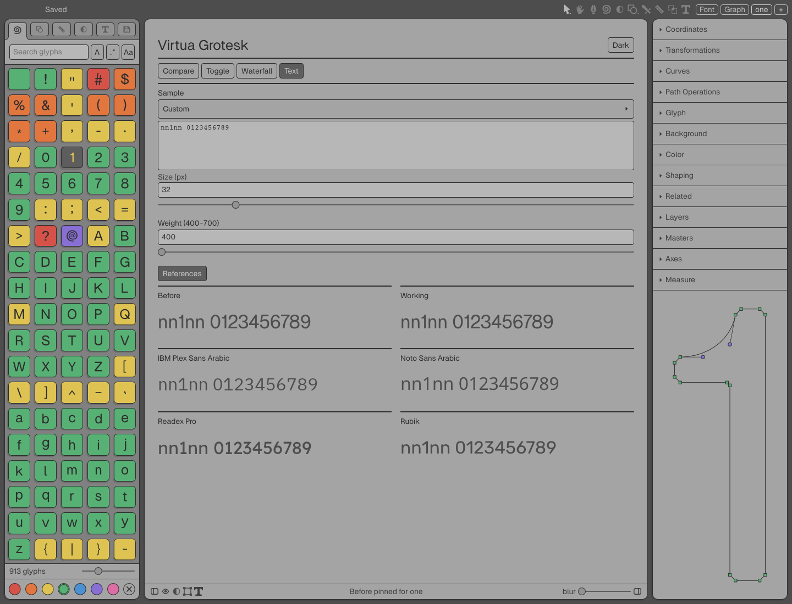
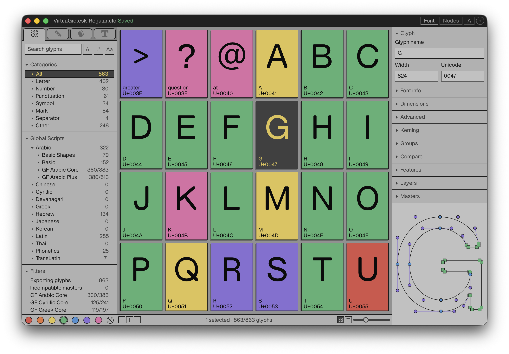
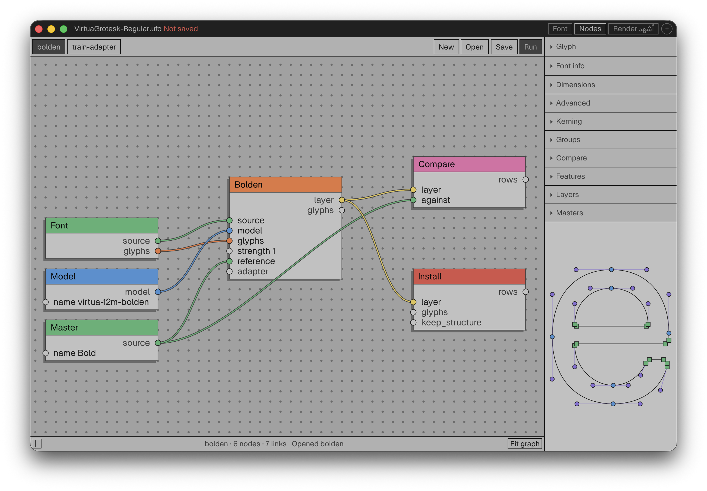
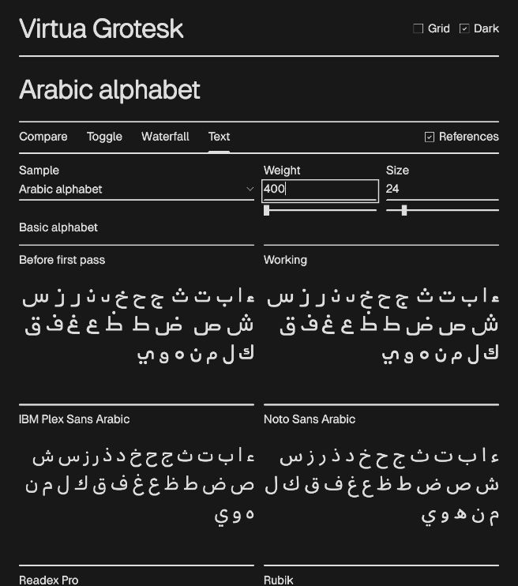
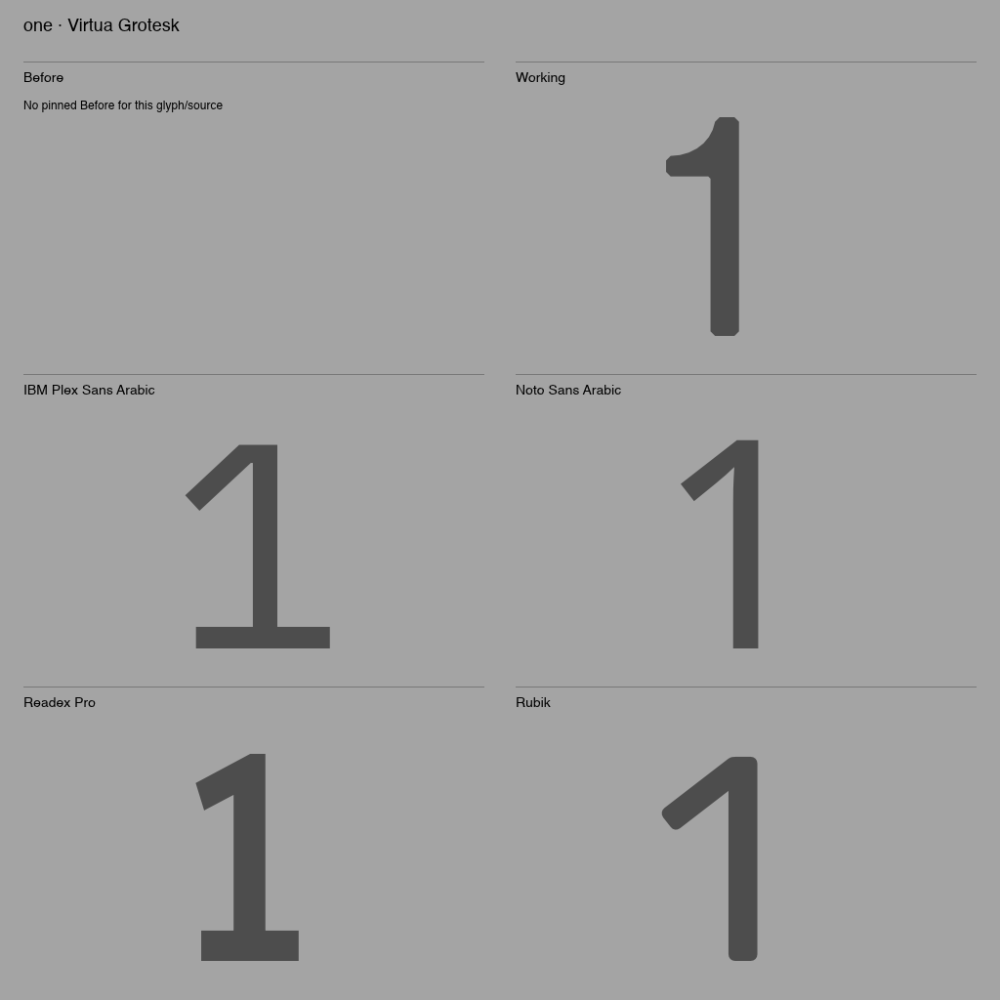
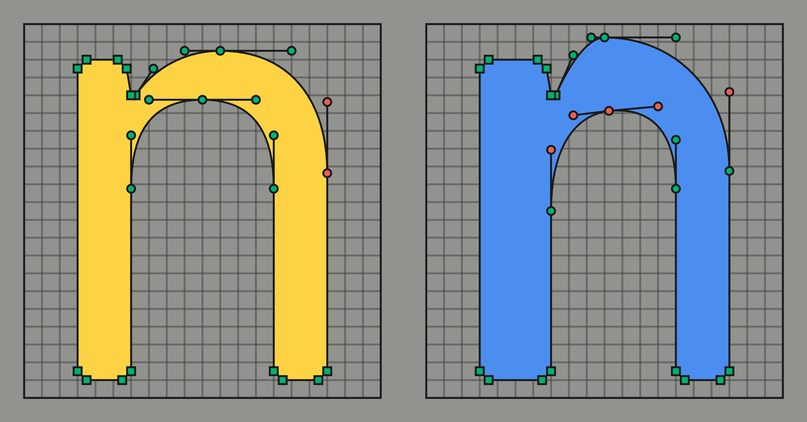
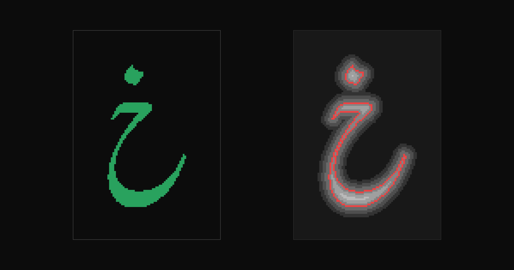

This post is the written version of my workshop at ATypI 2026 Sharjah,
"Local AI for Type Design with the Runebender Font Editor." It explains
how a type designer can train, run, and review small AI models on their
own computer. Nothing in this workflow sends drawings to a cloud service.

The workflow runs inside [Runebender](https://runebender.org), a free
and open-source font editor. Its first public release,
[0.1.0-alpha.1](https://github.com/fontgarden/runebender/releases/tag/v0.1.0-alpha.1),
is a signed and notarized DMG for Apple silicon Macs. Below, the proof
page compares a glyph in Virtua Grotesk with four reference fonts that I
keep in the project folder.



### Section Index

1. Runebender
2. Why local AI
3. Open models and their licenses
4. Training on fonts
5. Fonts as training data
6. What Runebender does with models
7. Training your own models
8. Hardware
9. Setup
10. What comes next

### 01. Runebender

Runebender is a cross-platform font editor built on the
[Linebender](https://linebender.org) ecosystem of Rust crates. The
desktop app runs on macOS and Linux. An experimental WebAssembly version
runs in the browser. The license is Apache 2.0 or MIT.

UFO and Designspace are the main source formats. Runebender also opens
Glyphs and Fontra sources with basic alpha support, and it imports
compiled TTF and OTF fonts.



The editor is about 178,000 lines of Rust. The interface uses Xilem and
Masonry from Linebender, and the curve math uses kurbo. norad reads and
writes UFO. Google's [fontc](https://github.com/googlefonts/fontc)
compiles fonts, and [HarfRust](https://github.com/harfbuzz/harfrust),
the Rust port of HarfBuzz, shapes text. The model runtime,
[font-ml](https://github.com/eliheuer/font-ml), is also Rust, built on
Hugging Face's [Candle](https://github.com/huggingface/candle). Python
appears only in release scripts and in optional recipes.

One language from the curve math to the window to the models gives one
native program with no runtime to install. The compiler checks memory
safety. The same code compiles to WebAssembly for the browser.

Runebender follows the design philosophy of
[RoboFont](https://robofont.com). RoboFont's
[design principles](https://robofont.com/documentation/topics/robofont-design-principles)
say that "the typeface designer should make the decisions and have the
power to design their fonts," and that a designer who does not shape
their own tools is in a vulnerable position. Runebender is a starting
point for designers who build their own tools: Python recipes, node
graphs, connections for AI agents, and the source code itself. Building
from source is a normal way to use it. The DMG is a quick start.

The differences from other editors are the combination. Glyphs is
commercial and runs on macOS only. FontLab is commercial and runs on
macOS and Windows. RoboFont is commercial and runs on macOS. FontForge
and Fontra are open source. Runebender adds a permissive license,
native and browser versions from one codebase, and local AI built into
its design from the start. It is alpha software. The established editors
are far more complete. Runebender is a base to build on.

### 02. Why Local AI

If every type studio does its work through one AI company, that company
controls the type industry. It sees every studio's drawings and
requests. It sets the prices, and it can change the terms or close
access. It can also release its own fonts and font tools.

The risk is not only data. It is know-how: the methods and judgment that
make one studio different from another. A studio that runs its drawing,
spacing, and corrections through someone else's model passes that
know-how to the model's owner, a little at a time. Nobody has to intend
it. AI labs also enter their customers' markets. In July 2026, Anthropic
released Claude Design, a design tool that competes with Figma.

The current terms differ by plan. Since September 2025, Anthropic trains
on chats from its consumer plans unless the user opts out. Commercial
and API use is not used for training under the current terms. Terms can
change, and training is not the only way that know-how leaves a studio.

Local models give a studio:

- Independence from any one company.
- Ownership of its drawings, models, and fonts.
- Client work that stays on its own machine. Custom type is often under
  a non-disclosure agreement.
- No fee for each use.
- Models that it can open and study.
- A model file on disk that keeps working. A cloud model can be
  retired, repriced, or changed by its provider.

Type has seen this before. Closed font formats gave way to open ones.
Adobe ended support for PostScript Type 1 fonts in new releases of its
apps in January 2023. OpenType is an open specification, published as an
ISO standard. UFO is an open-source source format that most font
editors read and write. Mark Zuckerberg's
[essay on open-source AI](https://about.fb.com/news/2024/07/open-source-ai-is-the-path-forward/)
makes the same argument from software: open Linux replaced the closed
versions of Unix.

### 03. Open Models and Their Licenses

This section follows parts of Nathan Lambert's lecture
[Open Language Models](https://natolambert.com/slides/2026/harvard/lecture.html)
(Harvard, October 2026), adapted for type design.

**Open weights** are released for anyone to download and run: Alibaba's
Qwen, Google's Gemma, OpenAI's gpt-oss, DeepSeek, Moonshot AI's Kimi,
and Zhipu's GLM. **Open source** adds the training data and code, so
that a model can be studied and rebuilt: EleutherAI's Pythia, Ai2's
OLMo, and Hugging Face's SmolLM. Open weights are like a compiled font.
Open source is like a font released with its sources and build scripts.
Claude and GPT are available only through an API.

The best open models trail the best closed models by a few months.
The gap is about three months on Artificial Analysis's general index,
and about five on Epoch AI's software engineering index. The gap is getting smaller. Most
of the leading open models now come from Chinese labs. These large
models do not run on a laptop, but the smaller models in this workflow
come from the same families.

A model that runs locally sends nothing to the lab that made it. Its
license and its behavior still matter, so test a model on your own
work before you rely on it.

Model licenses work like font licenses. MIT and Apache 2.0 are
permissive, like the SIL Open Font License without its Reserved Font
Name clause. Custom model licenses add conditions such as revenue
limits, naming rules, and acceptable-use policies, like a foundry
EULA. Most of those custom terms have not been tested in court.

These are the licenses of the models and software that Runebender uses.
I read the license field inside each model file.

| Model or program | License |
| --- | --- |
| Qwen3.5 4B, Qwen3.6 27B, Qwen3.6 35B A3B | Apache 2.0 |
| Gemma 4 26B A4B | Apache 2.0 |
| gpt-oss 20B | Apache 2.0 |
| Whisper small | MIT |
| llama.cpp, whisper.cpp | MIT |
| Runebender, font-ml | Apache 2.0 or MIT |

### 04. Training on Fonts

I live and work in the United States, so this section uses US law. I
work up to the limit of what US law allows, and stay within it. None of
this is legal advice.

The [OFL FAQ](https://openfontlicense.org/ofl-faq/) (version
1.1-update7, November 2023) answers part of the question. Question 1.25
says that a font produced by an AI system "whose input or training data
contains any source file from a font project licensed under the OFL
should be considered a derivative work." That font must stay under the
OFL. Question 1.26 says that graphics made with AI tools from OFL fonts
are normal use. Neither answer says anything about the trained model
weights.

Many foundry licenses now forbid AI training. Monotype's MyFonts EULAs
forbid using font software, rendered glyphs, outlines, or kerning data
to train AI models. Commercial Type, Ama Foundry, and BAL Foundry have
similar clauses. Older EULAs say nothing about AI.

In the US, font software is protected by copyright as a computer
program, but typeface designs are not. Design patents can protect novel
designs, and trademarks protect names. A model learns from outlines,
which are part of the font software, but it can output letterforms
only. Whether trained weights copy the software is not settled.

That leaves an open question: what license does a model trained on a
font carry? Are the weights a Modified Version of the font? Is shipping
the model the same as shipping the font? Does it matter if the model can
redraw the font exactly? I do not have an answer yet. For models trained
on my own fonts, I hold the copyright, so I can choose.

### 05. Fonts as Training Data

Most font AI projects train on scraped fonts and Google Fonts. As I
wrote in the [Virtua Grotesk post](/blog/virtua-grotesk), most fonts
were never built as training data. Their points land wherever each
designer put them. Each family has its own conventions, so a model
spends its capacity reconciling drawing habits instead of learning one
design. Normalizing the fonts removes information. Under the OFL FAQ,
fonts that a model makes from OFL training data stay under the OFL.

Bill Gurley
[describes](https://p3institute.substack.com/p/from-open-source-software-to-open)
open source as a business strategy: companies use it to commoditize an
expensive input or to weaken a stronger competitor. He does not discuss
fonts, but Google Fonts fits that pattern. Free fonts commoditized an
input to the web, Docs, and Android. It worked, and the fonts are widely
used, but the families were drawn by many designers to many standards.

AI changes the cost of drawing. A small team can draw a core set by
hand, let local models draft the rest in the same conventions, and grade
every glyph. The result can be an open font library held to one high
standard, where every font is also clean training data.

Other industries already do this with open models. In August 2026,
[Harvey](https://www.harvey.ai/blog/post-training-update-harvey-tenet)
post-trained an open Kimi K3 base model for legal work, so that law
firms can own their models. Harvey reports nearly twice as many held-out
tasks completed as the base model, from its own evaluations. In
September 2026,
[Mercor and SkyRL](https://www.mercor.com/blog/training-frontier-knowledge-work-agents-a-397b-rl-training-guide-with-skyrl/)
trained an open Qwen3.5 397B model on about 2,000 expert tasks. Its
score rose from 16.1% to 27.3%, and they released the weights and the
training script.

The same pattern works for type. An open model plus a foundry's graded
glyphs is a model that the foundry owns. The expert data is the
drawings and the corrections. The score is the distance between a draft
and the outline that the designer kept.

### 06. What Runebender Does With Models

In Runebender, a model is a folder of files on your disk, under
`~/Runebender/models`. A font's own models go beside it, in
`MyFont.models/`, so the models stay with the font. The editor downloads
nothing and sends nothing.

Every model output is a proposal. A model never edits the font directly.
The designer installs or discards each draft, only a person grades a
glyph as approved, and only the designer saves.

**Training from scratch.** The Local AI Shapes tool trains a small model
on the shapes in a font. Then you drag a box, choose a shape, and the
model draws it. On an M4 Pro laptop, a thorough run takes 29 minutes.
The [Local AI Shapes post](/blog/local-ai-shapes-tool) has the details.

**Fine-tuning.** Fine-tuning continues training from an existing model
instead of from random weights. It needs less data and less time. In the
editor, Add This Font's Shapes adds new shapes in about two minutes.
font-ml also trains adapters: a small set of weights trained over a
frozen base model, in the shape of a LoRA.

**Bolden.** A bolden model moves the points of a Regular glyph to draft
its Bold. The point structure stays the same, so the masters still
interpolate. Drafts come in batches of 20, marked orange until a person
grades them.

**Chat.** The Chat panel runs open-weight chat models through
[llama.cpp](https://github.com/ggml-org/llama.cpp). Small models cannot
calculate a stem width from a point list, but they do call the correct
tools in the correct order. So the tools return the measurements
directly. In one test, Qwen3 4B gave three wrong answers for the stem of H.
With a measuring tool, it gave the correct value, 100. The Talk button records a spoken request, and a local
[whisper.cpp](https://github.com/ggml-org/whisper.cpp) model writes it
into the chat field.

**The node editor.** Graph is a node editor similar to ComfyUI. Nodes
for a font, a model, a master, and tasks such as Bolden, Compare, and
Install connect into a workflow. A workflow is a file that runs in the
editor or from the command line.



**Proof review.** The proof page has four modes. Compare shows a glyph
next to its earlier state. Toggle switches between the two in place.
Waterfall and Text set compiled, shaped text at several sizes.

Reference fonts go in a `reference-fonts` folder at the nearest Git root
of the font project. Add `/reference-fonts/` to `.gitignore` before you
put licensed fonts there. Runebender picks the nearest weight. If a
reference font does not have a glyph, the proof shows that it is
missing instead of drawing it in another font.

The [Virtua Grotesk](https://github.com/eliheuer/virtua-grotesk) design
review, a browser proof that coding agents use, has the same four modes
and reads the same folder. The two renderers are different, so they are
not pixel-identical, but a designer can move between them without a
second set of conventions.



**Agents.** `runebender mcp --install` registers the editor with
Claude Code, Codex, Claude Desktop, and Cursor through the Model Context
Protocol. The agent works on the open document, including unsaved
changes, with 48 tools and 6 workflows. It reads, measures, proofs, and
proposes. The designer installs.

The `review_proof` tool gives an agent the same comparison image that
the designer sees. The request must name the exact document revision, so
a stale request fails. The tool never saves or applies anything. I
tested it with the Pi coding agent. The Chat panel sends the same image
to its model, which must accept image input.



### 07. Training Your Own Models

A model learns in a loop. It starts from random weights, predicts a
training example, measures the error, and adjusts its weights a little.
It repeats this many times. Then it is scored on examples that it never
saw during training.

I have trained two small font models on my own machines, with two
different approaches.

| | Virtua-12M | NeuralType Nasta'liq |
| --- | --- | --- |
| Draws | outlines, as drawing commands | shapes, as distance fields |
| Learns from | its own font's sources | the shaped output of Gulzar |
| Task | Bold from Regular, sketch to outline | each shape from its context |
| Parameters | 12.54 million | 1.36 million |
| Held-out score | Bold error 24.0, baseline 31.3 | shape overlap 0.945 |

**[Virtua-12M](/blog/virtua-grotesk)** is a small transformer. A codec
turns each UFO glyph into tokens: commands such as MOVE, LINE, and
CURVE, and one token for each coordinate. Virtua Grotesk is drawn on the
same grid as the tokens, so the conversion is exact in both directions.
To draft a Bold, the model predicts a move for each Regular point. Its
output is an editable outline with real points.



**[NeuralType Nasta'liq](/blog/nastaliq-distilled)** is a neural font.
It was distilled from Gulzar, an OpenType Nasta'liq font. For each shape,
the network predicts a signed-distance field: a grid of distances to the
nearest edge. A tracer turns the zero crossing into a Bézier outline. A
small error moves an edge slightly instead of breaking the outline. That
suits Nasta'liq, where each letter depends on its neighbors.



Neither model needs a data center. Virtua-12M-v0.1 trained in 3 hours 20
minutes on a MacBook Pro with an M4 Pro, using
[MLX](https://github.com/ml-explore/mlx). On a Linux PC with an NVIDIA
RTX 2060 SUPER, an eight-year-old card with 8 GB of memory, a full run
takes twenty minutes. The Nasta'liq model trained with Candle on the
same card at about 100 seconds per epoch.

Measure every model honestly:

1. Hold out examples that the model never trains on.
2. Compare with a simple baseline, or with the teacher.
3. Run several seeds. My first Virtua-12M result, 20.9, was a lucky
   single run. Five seeds gave 24.0 ± 1.6.
4. State what the score misses. The Nasta'liq score measures shape only,
   on short strings, so it says nothing about new words.

### 08. Hardware

For local models, memory matters more than the processor. A model must
fit in memory: at 4 bits, a model takes about 0.6 GB per billion
parameters. A 4B chat model needs about 3 GB, and a 35B model about 22
GB. Memory bandwidth sets the speed, because each new token reads the
active weights once.

A mixture-of-experts model reads only part of its weights for each
token. Qwen3.6 35B A3B has 35 billion parameters but reads about 3
billion per token. It needs the memory of a large model and runs at the
speed of a small one.

There are three kinds of machine. A graphics card has fast memory, 24 to
32 GB on a consumer card, and NVIDIA's CUDA is supported by all training
tools. Unified memory, in Macs, AMD Strix Halo, and NVIDIA DGX Spark,
shares one larger pool between processor and graphics. Multiple-card
machines are for labs and teams.

These are example machines, with US prices from October 2026. Memory
shortages raised many prices during 2026.

| Machine | Memory | Bandwidth | Price |
| --- | --- | --- | --- |
| PC with a used RTX 3090 | 24 GB | 936 GB/s | $700 to $1,050 per card |
| PC with an RTX 5090 | 32 GB | 1,792 GB/s | $2,400 to $4,300 per card |
| Strix Halo mini PC | 128 GB | 256 GB/s | from about $2,000 |
| Framework Desktop, Max+ 395 | 128 GB | 256 GB/s | $3,449 |
| NVIDIA DGX Spark | 64 or 128 GB | 273 GB/s | $3,999 at launch, now higher |
| Mac Studio, M5 Max | 36 to 128 GB | 460 to 614 GB/s | from $2,499 |
| Mac Studio, M5 Ultra | 96 to 512 GB | 1.2 TB/s | from $5,499 |

Start with the computer you have. The font models in this post train on
a laptop, and a 4B chat model needs 8 GB. When a real task is too slow,
buy for memory first.

### 09. Setup

Runebender needs a few helper programs and a models folder.

| Part | For | Install |
| --- | --- | --- |
| Runebender | everything | DMG, or Cargo |
| llama-server | the Chat panel | `brew install llama.cpp` |
| font-ml | font models | Cargo |
| whisper-server | voice input, optional | `brew install whisper.cpp` |
| Designbot | proof images, optional | Cargo |

llama-server stays outside the app on purpose. One shared server can
then serve Runebender, the Pi coding agent, and other tools at the same
time. If you use Homebrew, upgrade `llama.cpp` and `whisper.cpp`
together, because they share one library.

On an Apple silicon Mac, download the DMG from
[runebender.org](https://runebender.org). On an Intel Mac or Linux,
build from source with Rust 1.96 or newer:

```sh
cargo install --git https://github.com/fontgarden/runebender
cargo install --git https://github.com/eliheuer/font-ml --features metal
```

On Linux with an NVIDIA card, build font-ml with `--features cuda`
instead of `metal`. For a CPU only, leave out the feature.

A coding agent can also do the setup. Give Claude Code or Codex this
request:

```text
Read https://runebender.org/local-ai-setup-prompt.md
and set up Runebender for local AI on this machine.
```

Most chat models come from [Hugging Face](https://huggingface.co). The
original models are published by labs such as Qwen, Google, and OpenAI.
llama.cpp needs GGUF files, which ggml-org and Unsloth publish. Font
models you train yourself.

A model is a file from someone else. Check it before you run it:

1. Check the publisher's account name letter by letter.
2. Use GGUF or safetensors files. These hold numbers, not code.
3. Do not load PyTorch pickle files (`.pt`, `.pth`, `.pkl`) from unknown
   publishers. Pickle files can run code when they load.
4. Compare the SHA-256 checksum with the value on the model page.
5. Read the license.
6. Keep llama.cpp updated.

A checksum shows that the file is the one the publisher released. It
does not show that the model behaves well. In Runebender, a model can
only read, proof, and propose.

The [runebender-local-ai-demo](https://github.com/eliheuer/runebender-local-ai-demo)
repository has five exercises: drawing from text, training and
boldening, a chat model, the node editor, and a real font.

### 10. What Comes Next

Runebender is alpha software. The next release, 0.1.0-alpha.2, will
bundle font-ml in the DMG. Manual save-and-reopen tests and a full
update install are still on the test list.

Planned work includes a Finetune button in the editor, a chat model
catalog with one-click downloads, drafting from a sketch, and spacing
and kerning drafts. Each one follows the same rules: drafts are
proposals, only the designer grades, and every model is scored against
drawings that it never saw.

The long-term aim is fonts that are models rather than tables of
outlines, trained on a designer's own drawings, on the designer's own
computer.

The slides for the workshop are at [/slides/localai](/slides/localai).
