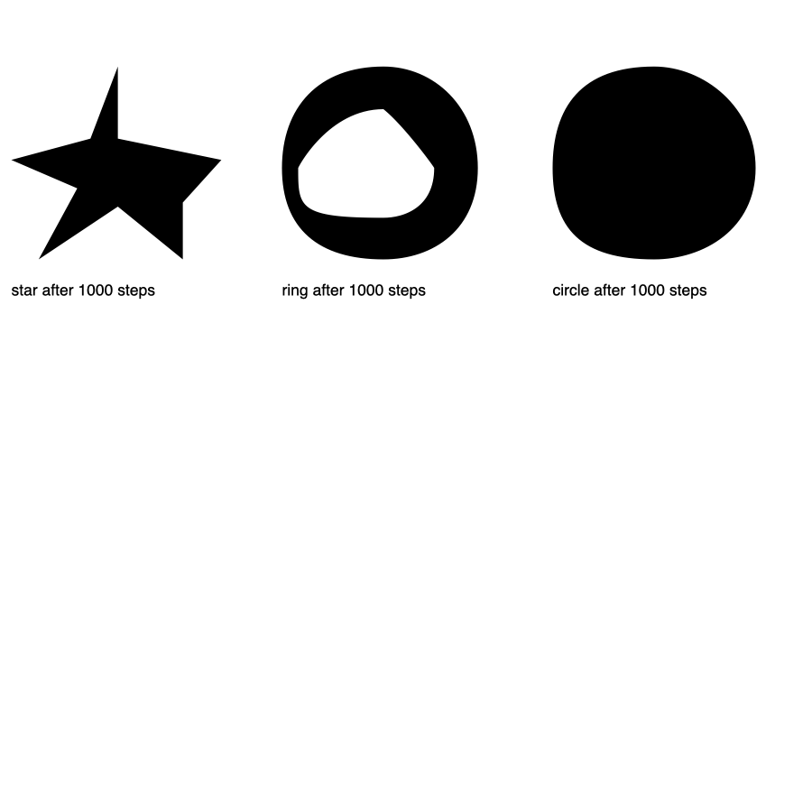

RoboFont famously shipped without a shapes tool and expected you to
write your own. Runebender ships with one, and this post is about the
second one: a local AI shapes tool. You drag a box on the glyph, type a
word, and a model fills the box with that shape. The model is small and
you train it yourself, inside the editor, from your own drawings.
Nothing is downloaded and nothing leaves your machine.

That is the whole hello world of local AI: your drawings in, a model
out, the model used from a tool. Everything bigger is this loop with
more data.

The code and the sample font are in
[runebender-local-ai-demo](https://github.com/eliheuer/runebender-local-ai-demo).
The model runtime is [font-ml](https://github.com/eliheuer/font-ml).
Both are Apache-2.0 or MIT.

{/* DRAFT STATUS: written while the tool is built. TODO marks what is
    filled from real runs and screenshots, not written ahead of them. */}

### Section Index

1. What you need
2. Draw the shapes
3. Train the model
4. Use the tool
5. Add your own shapes
6. How it works
7. What it cannot do, and what to try next

### 01. What You Need

A mid-range computer: an Apple Silicon laptop, or a Linux PC with a
gaming GPU, or a plain CPU and patience. Two programs: the editor and
`font-ml`, which runs and trains the models.

```sh
cargo install --git https://github.com/eliheuer/runebender-xilem
cargo install --git https://github.com/eliheuer/font-ml --features metal   # macOS
cargo install --git https://github.com/eliheuer/font-ml --features cuda    # Linux with NVIDIA
cargo install --git https://github.com/eliheuer/font-ml                    # CPU
```

Make sure that both programs answer:

```sh
runebender --help
font-ml tasks
```

The second command lists the tasks the models can do. The tool uses
two of them: `train-draw` and `draw`. The editor runs both for you;
the commands are here so you can see there is no magic.

TODO: screenshot of `font-ml tasks` output.

### 02. Draw the Shapes

A shapes model learns from one UFO. Each glyph in it is a shape, and
the glyph's name is the word for the shape. The model learns "circle"
from a glyph named `circle`.

The sample font that ships with the editor has 16 such glyphs. It is
also in the demo repo as `fonts/Shapes.ufo`, where it was generated by
a small Rust program so the post repeats on any machine.


To use your own drawings instead, open a new UFO, draw a shape with
any tool, and name the glyph. A name with a hyphen is two words:
`five-star`. A suffix after a dot is ignored, so `circle.big` is one
more example of "circle".

### 03. Train the Model

Open any glyph, pick **Local AI shape** from the shapes dropdown in the
toolbar, and the right panel shows the tool's section. With no model
yet it offers two buttons: **Train from this font** and **Train from
the sample shapes**. Pick a length first: **Quick** takes about 12
minutes and draws rough shapes; **Thorough** takes about 30 and draws
clean ones.

TODO: screenshot of the panel before training.

While it trains, the panel shows the step, the time left, and what
the model draws right now for three of the words. The drawings start
as scribbles and sharpen as the loss falls. That is the moment people
understand what training is.

TODO: screenshot of the panel mid-training with the three samples.

The same run from a shell, which is what the button executes:

```sh
font-ml run train-draw --source fonts/Shapes.ufo --out ~/Runebender/models/shapes/shapes-base \
    --steps 15000 --spare 16 --sample-words circle,star,triangle
```

The output folder holds three files:

| File | What it is |
| --- | --- |
| `config.json` | The shape of the network, and the task and format it was trained for |
| `weights.safetensors` | The trained weights |
| `vocab.txt` | Every word the model can read, one per line, plus 16 spare slots |

On an M4 Pro laptop the thorough run of 15,000 steps takes 29 minutes
and ends at a validation loss of 0.85. The quick run reaches about
1.05 at 6,000 steps.

### 04. Use the Tool

With a model chosen, drag a box on the glyph where the shape should go.
Hold Shift for a square. A word field opens under the box. Type
`star` and press Enter.

TODO: screenshot of the box, the word field, and the ghost.

The model draws into the box and the result shows as a ghost. Enter
keeps it, and it becomes part of the glyph as one undo step. Tab asks
for another option; the model samples a different drawing of the same
word. Esc drops it. The panel lists every word the model knows, so
there is nothing to guess.

The same call from a shell writes the drawing into a glyph as a
proposal layer:

```sh
font-ml run draw --model ~/Runebender/models/shapes/shapes-base --source fonts/Shapes.ufo \
    --glyph octagon --prompt star --box 100,100,400,400 --write
```

### 05. Add Your Own Shapes

The base model knows the 16 sample words. Your font has shapes of its
own: a teardrop terminal, a particular dot. Draw one in a glyph, name
the glyph `teardrop`, and click **Train from this font**. The run
continues from the chosen model instead of starting over: the new word
takes one of the model's spare slots, the base's own drawings are
replayed so nothing is forgotten, and the whole thing takes about two
minutes.

TODO: screenshot of a font's own word being learned.

In the demo repo this was measured by holding `star` and `ring` out of
the base and adding them afterwards: 1,000 steps, 1 minute 51 seconds.
After that the ring is a ring and the star is a star with uneven arms.



The model a font trains is saved beside the font, in
`MyFont.models/shapes/`, so it travels with the font. The base lives in
`~/Runebender/models/shapes/`.

### 06. How It Works

The model is a small decoder transformer, the same kind as a language
model, with 5.5 million parameters. It reads one sequence of tokens
and predicts the next token. A training sequence looks like this:

```
BOS star SEP ADV C100 C100 C400 C400
MOVE C300 C500 LINE C340 C380 ... CLOSE EOS
```

Everything before `SEP` is the word. After `SEP`, four coordinates give
the box the shape fills: left, bottom, width, height. The model does
not predict this part; the tool supplies it from the box you dragged.
After that come the drawing commands, `MOVE`, `LINE`, `CURVE`, and
`CLOSE`, each followed by coordinate tokens on a 2-unit grid. The model
predicts this part. `EOS` ends the drawing.

The trainer makes the sequences from the UFO. For each sample it takes
one glyph, picks a box of some width and position, stretches the
drawing a little or not at all, and fits it to the box. A glyph named
`circle` becomes thousands of different boxes. The model never sees
the same sample twice, and the loss is measured only on the drawing,
never on the word or the box.

Words are ordinary tokens, one per word. A fresh model also gets
sixteen spare word tokens with no drawings. When a font adds a word,
the word takes a spare token and training continues from the base's
weights. No other token moves, so the base's words keep working.

At run time the tool sends the word and the box. The model continues
the sequence one token at a time until it produces `EOS`. By default it
always takes the most likely token, so the same word in the same box
gives the same drawing. Tab asks for a sampled drawing instead, which
is where the other options come from. The drawing commands become
contours and go into the glyph through the ordinary edit path, which
is why undo works on them.

### 07. What It Cannot Do, and What to Try Next

The model knows the words it was trained on and nothing else. It does
not know "heart" until a glyph named `heart` is drawn and trained. It
does not know "next to the dot of the i"; a sentence like that needs a
model that understands glyphs and English, which is a chat model with
tools, not a model you train in minutes. The small model is the right
first step because every part of it is yours: the data, the words, the
weights.

Three things to try next, in order of effort:

1. Draw more shapes and train again. Each glyph name is one more word.
2. Train longer. Thorough is cleaner than Quick for exactly that reason.
3. Label parts of real glyphs. Today a word comes from a whole glyph's
   name. The next step is to select some contours in any glyph and say
   "add to shapes as teardrop", so a real font teaches its own parts
   without a shapes font at all.
